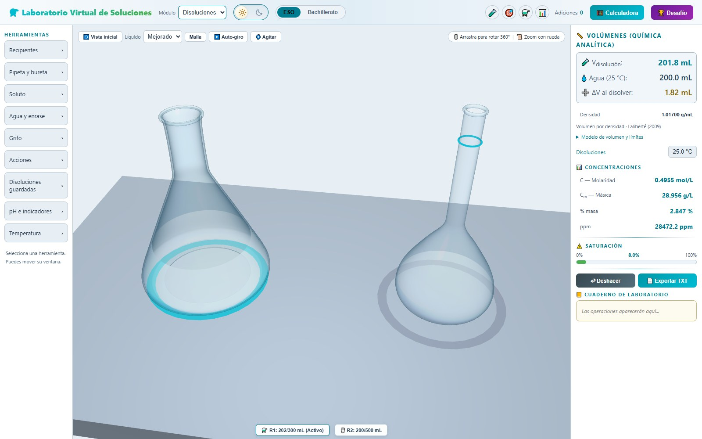
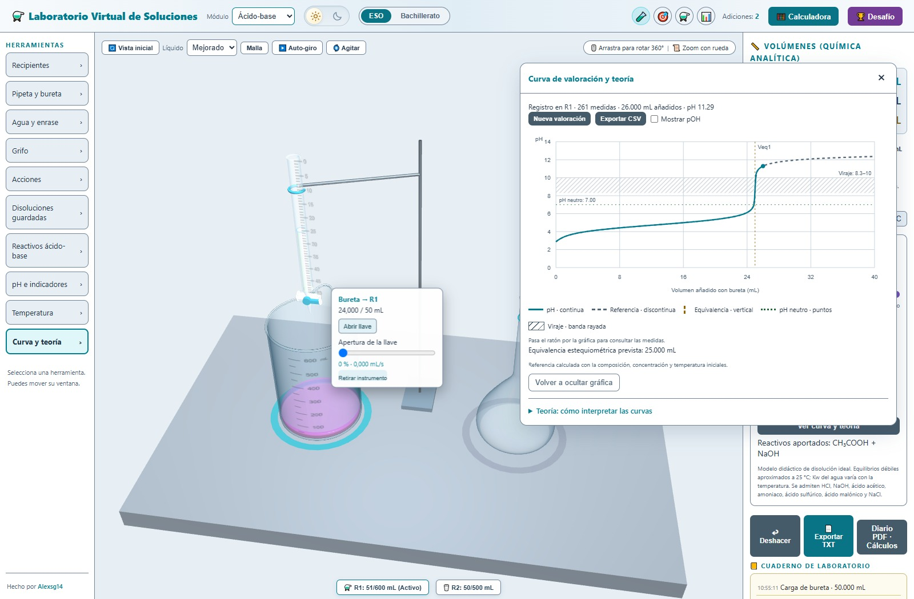

<div align="center">

# Virtual Lab

### Química en el navegador: preparar, observar y comprender.

Laboratorio interactivo para estudiar disoluciones y valoraciones ácido-base mediante una escena 3D, instrumentos de dosificación y resultados calculados en tiempo real.

**Three.js · TypeScript · JavaScript · Vite**

[Instalación](#instalación) · [Disoluciones](#disoluciones) · [Valoraciones](#valoraciones-ácido-base) · [Modelo científico](#modelo-científico) · [Desarrollo](#desarrollo)

</div>


## Un laboratorio para experimentar

Virtual Lab permite relacionar las operaciones de laboratorio con las magnitudes químicas que las describen: **masa, volumen, concentración, densidad, temperatura y pH**. Está orientado al aprendizaje de química en ESO y Bachillerato.

| Preparar | Manipular | Analizar |
| :--- | :--- | :--- |
| Añadir soluto y agua, enrasar y diluir. | Transferir alícuotas con pipeta, regular una bureta y agitar. | Consultar concentración, densidad, pH y curvas de valoración. |
| Elegir recipiente y capacidad. | Calentar, enfriar y guardar disoluciones. | Exportar resultados a TXT, medidas de valoración a CSV y diarios con cálculos a PDF/LaTeX. |

La interfaz ofrece modos día y noche, cámara 3D, malla de referencia opcional, información de los recipientes y la posibilidad de deshacer operaciones.

Los estados se acompañan de texto o marcas, las gráficas distinguen sus series por trazos y el color previsto del indicador tiene una descripción textual. [Alcance de las mejoras de color y contraste](docs/colores-accesibilidad.md).

## Disoluciones

### El volumen de agua no es el volumen de disolución

Para preparar una disolución de concentración conocida hay que controlar el **volumen final**, no solo la cantidad de agua añadida. Al disolver un soluto, las interacciones con el agua pueden producir un aumento o una contracción del volumen.



**Ejemplo: preparar 200 mL de NaCl 0,5 M a 25 °C.**

1. Calcula la cantidad de soluto: `n = C × V = 0,5 × 0,200 = 0,100 mol`.
2. Pesa **5,844 g de NaCl**.
3. Disuelve con una cantidad de agua inferior al volumen objetivo.
4. Completa con agua hasta **200 mL de disolución**.

| Procedimiento | Volumen final | Molaridad |
| :--- | ---: | ---: |
| Disolver y enrasar a 200 mL | 200,000 mL | 0,5000 mol/L |
| Añadir el soluto a 200 mL de agua | ≈ 201,821 mL | ≈ 0,4955 mol/L |

El simulador calcula el agua necesaria para el enrase y actualiza las concentraciones después de cada adición o transferencia. Para los solutos con datos de densidad, el volumen se obtiene de la composición y la temperatura de la muestra.

Los desafíos de preparación incluyen mol/L, g/L, % m/m, ppm y mol/kg de agua. Cada reto comprueba la concentración en la unidad solicitada y el volumen final de disolución de forma independiente.

### Material y operaciones

- **Recipientes:** vaso de precipitados, matraz aforado, Erlenmeyer y probeta, con capacidades ajustables.
- **Pipeta:** carga independiente, transferencia de alícuotas y dosificación por gotas.
- **Bureta:** llave de apertura regulable, goteo a bajo caudal y lectura del volumen entregado.
- **Agua y enrase:** adición directa o mediante grifo, con límite de llenado.
- **Registro:** historial de operaciones, reservas de disoluciones y exportación de resultados.

## Valoraciones ácido-base

La dosificación con bureta permite seguir la evolución del pH y comparar el registro con una referencia de equilibrio calculada a partir de las condiciones iniciales.



En esta valoración, **25 mL de ácido acético 0,1 M** reciben **NaOH 0,1 M**. La equivalencia estequiométrica se alcanza a los **25 mL de valorante**, con un pH superior a 7 por tratarse de un ácido débil y una base fuerte.

| Elemento de la gráfica | Interpretación |
| :--- | :--- |
| Curva continua | Evolución del pH calculado durante las adiciones. |
| Línea discontinua | Referencia calculada con la composición inicial. |
| Banda de color | Intervalo de viraje del indicador. |
| Marcas verticales | Volúmenes de equivalencia estequiométrica previstos. |

El módulo admite **HCl, NaOH, CH₃COOH, NH₃, H₂SO₄, ácido malónico y NaCl**. Incluye indicadores, lectura de pH y pOH, pausa y reanudación de la dosificación y exportación de la curva a CSV. Los ácidos dipróticos incorporan dos etapas de disociación; sus equivalencias no siempre generan dos saltos de pH separados.

## Armario de reactivos

Consulta botes de referencia de **HCl acuoso al 36 % m/m, H₂SO₄ concentrado al 98 % nominal, NaOH en lentejas y NaCl sólido**. Sus fichas incluyen propiedades, especificaciones, representaciones de etiquetas de seguridad e indicaciones H/P seleccionadas con enlaces a la documentación del fabricante.

Desde **Soluto → Desde un bote comercial** (o **Reactivos ácido-base → Desde un bote comercial**), puedes calcular una preparación y añadir producto al recipiente activo. El HCl aporta tanto soluto como agua; el volumen final se recalcula. Los sólidos se representan explícitamente como muestras idealizadas: la pureza mínima declarada no se interpreta como ensayo exacto. Las adiciones y sus factores de conversión quedan en el diario PDF y LaTeX.

[Datos, fuentes y alcance del armario](docs/armario-reactivos.md).

## Diario de laboratorio

El botón **Diario PDF · Cálculos**, en el historial, genera un informe del recipiente activo con autor, observaciones, operaciones registradas y factores de conversión para **mol/L, g/L, % m/m, ppm y mol/kg de agua**. Esta primera versión admite disoluciones de un único soluto y utiliza el volumen final calculado, sin presuponer un enrase correcto.

[Ver un diario de ejemplo en PDF](public/examples/diario_laboratorio_ejemplo.pdf) · [Funcionamiento y preparación](docs/diario-laboratorio.md)

El PDF se compila con LaTeX **dentro del navegador**, sin instalar MiKTeX ni enviar datos a servicios externos. Para preparar una copia, ejecuta una vez con conexión a Internet:

```sh
npm run preparar:latex
```

Se descargan unos 38 MB de compilador, fuentes y paquetes en `public/vendor/latex/`, con comprobación de integridad. Estos recursos generados no se versionan en Git. Para distribuir una copia que funcione sin Internet, incluye esa carpeta ya preparada y las dependencias habituales del laboratorio. Ejecuta la preparación antes de compilar si vas a distribuir `dist/`.

La descarga del archivo `.tex` y la apertura del PDF de ejemplo funcionan sin preparar el compilador. El modelo químico sigue siendo el mismo modelo ideal descrito más abajo.

## Instalación

### Requisitos

- **Node.js 24 LTS**, con npm.
- Un navegador con soporte WebGL.

```sh
git clone https://github.com/Alexsg14/VirtualLab.git
cd VirtualLab
npm ci
npm run dev
```

Abre **http://localhost:5173**. En Windows también puedes iniciar el laboratorio con **`Iniciar_laboratorio.cmd`**. Mantén abierta la terminal y pulsa `Ctrl+C` para detener el servidor.

> [!NOTE]
> La primera instalación de dependencias requiere conexión a internet. La aplicación se ejecuta mediante un servidor local; no abras `index.html` directamente como archivo.

### Compilar para distribuir

```sh
npm run build
npm run preview
```

La web compilada se genera en **`dist/`**. La vista previa está disponible en **http://localhost:4173**. Para desplegarla en un alojamiento estático, publica el contenido de `dist/`.

### GitHub Pages

El repositorio incluye un despliegue **manual**: **Actions → Publicar laboratorio en Pages → Run workflow**. La primera vez hay que seleccionar **GitHub Actions** en **Settings → Pages**. Subir cambios a `main` no actualiza automáticamente la web.

Antes de publicar se ejecutan las pruebas, se prepara LaTeX y se comprueba un PDF real sobre la web compilada. Se publica únicamente `dist/`.

[Configuración, actualizaciones y retirada](docs/github-pages.md).

## Modelo científico

### Densidad y volumen

El cálculo conserva las masas de agua y soluto y aplica la relación:

**V(T, w) = masa total / ρ(T, w)**

La correlación de **Laliberté (2009)** permite calcular la densidad en función de la temperatura `T` y de la fracción másica de soluto `w`. Se han incorporado parámetros verificados para:

**NaCl · NaOH · HCl · H₂SO₄ · NH₃ · CH₃COOH · CuSO₄ · CoCl₂ · KI · NaHCO₃**

La interfaz identifica el modelo utilizado y muestra avisos al extrapolar fuera del rango de los datos. Los parámetros corresponden a las formas anhidras del catálogo.

### Alcance y aproximaciones

| Área | Alcance actual |
| :--- | :--- |
| Solutos sin parámetros de densidad | Glucosa, ácido malónico, KMnO₄ y AgNO₃ utilizan un volumen aproximado, identificado en pantalla. |
| Mezclas de reactivos | El volumen es aproximado; no se calcula la contracción de reacción. |
| Solubilidad | Se supone disolución completa. No se simulan sólido sin disolver, precipitación ni cristalización. |
| Temperatura | Modifica la densidad y el volumen. No incluye evaporación, dilatación del recipiente ni calor de disolución o neutralización. |
| Equilibrio ácido-base | Modelo ideal, sin correcciones de actividad ni cinética de reacción. Constantes de equilibrios débiles de referencia a 25 °C; el producto iónico del agua varía con la temperatura. |
| Representación del líquido | Superficie libre con ondas y amortiguación; no es un modelo volumétrico SPH/PBF. |

**Referencia:** [Laliberté, 2009 · DOI 10.1021/je8008123](https://doi.org/10.1021/je8008123). Consulta los [parámetros de densidad](src/data/density.ts), las [ecuaciones](src/core/density.ts) y la [auditoría numérica](.tools/density-audit/validation.json).

## Desarrollo

### Estructura del proyecto

| Ruta | Responsabilidad |
| :--- | :--- |
| `src/core/` | Volumen, concentración y equilibrio químico. |
| `src/data/` | Catálogo de sustancias y parámetros de densidad. |
| `src/app/`, `src/state/`, `src/storage/` | Operaciones, estado de la sesión y reservas. |
| `src/instruments/` | Pipeta, bureta, grifo y control de temperatura. |
| `src/scene/` | Escena 3D, cristalería y representación del líquido. |
| `src/ui/`, `src/styles/`, `index.html` | Interfaz y presentación de resultados. |
| `src/education/` | Desafíos y herramientas educativas. |
| `tests/`, `scripts/` | Verificación y compilación. |

### Verificación

```sh
npm test
npm run typecheck
npm run build
```

Para ejecutar las pruebas de navegador:

```sh
npx playwright install chromium
npm run test:e2e
npm run test:acidbase
npm run test:titration
npm run test:instruments
npm run test:diary
```

La prueba del diario compila un PDF real sin conexiones externas cuando los recursos de LaTeX están preparados; si faltan, verifica el aviso y declara pendiente esa comprobación.

También se puede utilizar Edge instalado. En PowerShell, establece `$env:PLAYWRIGHT_CHANNEL='msedge'` antes de ejecutar las pruebas. Cada prueba inicia y detiene su propio servidor local.

### Persistencia

Las disoluciones guardadas se almacenan en el navegador, asociadas al perfil y a la dirección de la aplicación. No se sincronizan entre dispositivos ni mediante GitHub. Desarrollo (`localhost:5173`) y vista previa (`localhost:4173`) utilizan almacenamientos separados.