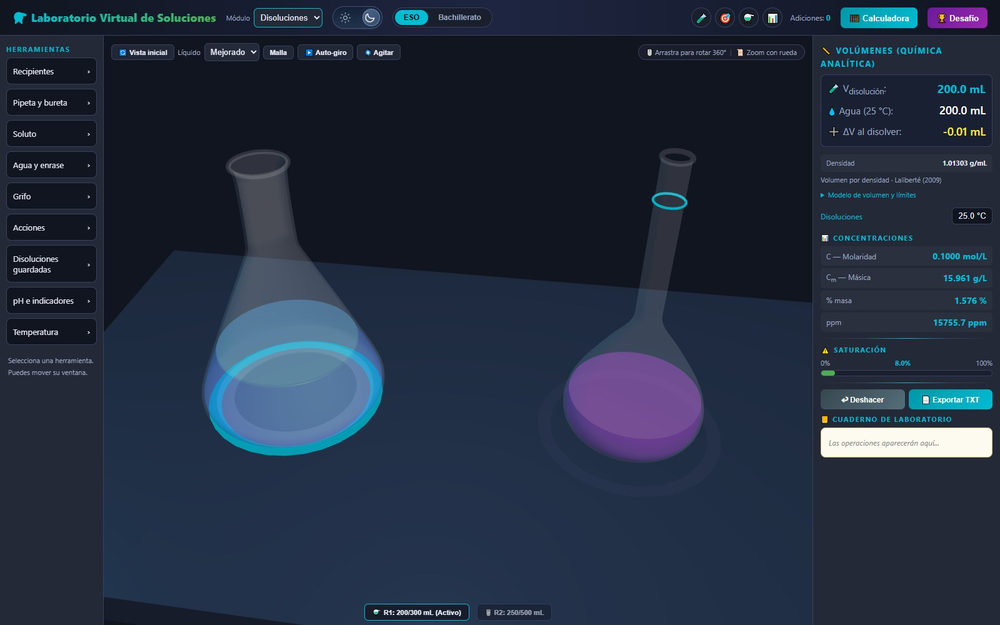

# Virtual Lab

**Laboratorio virtual de química para explorar disoluciones y valoraciones ácido-base desde el navegador.**

Prepara una disolución, completa hasta el volumen deseado, transfiere alícuotas y observa cómo cambian la concentración, la densidad y el pH. La escena 3D reúne los recipientes, los instrumentos y los resultados de la muestra activa.



[Empezar](#empezar) · [Disoluciones](#disoluciones-y-volumen-final) · [Ácido-base](#valoraciones-ácido-base) · [Modelo y límites](#modelo-químico-y-límites) · [Desarrollo](#desarrollo)

## Qué puedes hacer

| Área | Funciones |
| --- | --- |
| Disoluciones | Añadir soluto y agua, enrasar, diluir y consultar distintas formas de concentración. |
| Material de laboratorio | Vaso de precipitados, matraz aforado, Erlenmeyer y probeta; capacidades ajustables. |
| Pipeta y bureta | Carga independiente, transferencia de alícuotas, dosis y gotas; llave con caudal regulable. |
| Ácido-base | Preparar reactivos, medir pH y pOH, aplicar indicadores y registrar curvas de valoración. |
| Temperatura | Calentar o dejar enfriar y observar su efecto sobre densidad, volumen y pH neutro. |
| Trabajo y registro | Guardar y recuperar disoluciones en el navegador, deshacer y exportar resultados a TXT o curvas a CSV. |
| Interfaz | Modos día y noche, cámara 3D, malla opcional, controles de agitación y niveles ESO/Bachillerato. |

También incluye una calculadora y desafíos de preparación. El contador **Adiciones** registra incorporaciones de soluto; no cuenta experimentos completos ni resultados correctos.

## Empezar

Necesitas **Node.js 24 LTS**, npm y un navegador con WebGL. La primera instalación de dependencias requiere conexión a internet.

### Windows

1. Descarga y descomprime el repositorio, o clónalo.
2. Abre **`Iniciar_laboratorio.cmd`** con doble clic.
3. Mantén abierta la terminal mientras utilizas el laboratorio.

### Desde la terminal

```sh
git clone https://github.com/Alexsg14/VirtualLab.git
cd VirtualLab
npm ci
npm run dev
```

Abre **http://localhost:5173**. Para detener el servidor, pulsa `Ctrl+C` en su terminal.

> La aplicación necesita un servidor local: no abras `index.html` directamente con doble clic. Subir el código a GitHub tampoco publica automáticamente una web; GitHub Pages u otro alojamiento requieren configurar el despliegue.

## Disoluciones y volumen final

**Añadir 200 mL de agua no equivale a preparar 200 mL de disolución.** Para los solutos con parámetros verificados, el laboratorio calcula el volumen a partir de la masa total y de la densidad correspondiente a la composición y la temperatura. El volumen puede aumentar o contraerse al disolver.


Ejemplo a **25 °C**, con **5,844 g de NaCl**:

| Preparación | Volumen final | Concentración |
| --- | --- | --- |
| Disolver y enrasar a 200 mL | 200,000 mL | 0,5000 mol/L |
| Añadir el soluto a 200 mL de agua | ≈ 201,821 mL | ≈ 0,4955 mol/L |

En el primer caso se requieren aproximadamente **197,593 g de agua**. El control de enrase resuelve numéricamente cuánto añadir para alcanzar el volumen final solicitado.

Las transferencias conservan masas y moles y recalculan el volumen del destino. Los desafíos comprueban el **volumen final de disolución** y la concentración, con márgenes de **±0,05 mL** y **±0,2 %**, respectivamente.

## Valoraciones ácido-base

El módulo ácido-base permite trabajar con HCl, NaOH, ácido acético, amoniaco, ácido sulfúrico, ácido malónico y NaCl. Puedes incorporar reactivo puro equivalente o una disolución de concentración conocida, añadir agua y elegir un indicador.


La captura muestra una valoración de **25 mL de ácido acético 0,1 M con NaOH 0,1 M**, tras añadir 27 mL de valorante. El registro procede de las adiciones del propio simulador.

- La curva continua recoge el pH calculado durante la dosificación.
- La línea discontinua muestra la referencia calculada a partir de las condiciones iniciales.
- La banda señala el intervalo de viraje del indicador y las marcas verticales, las equivalencias estequiométricas previstas.
- Puedes pausar y reanudar la bureta, mostrar pOH y exportar las medidas en CSV.

Los ácidos dipróticos se modelan con dos etapas de disociación; sus equivalencias no siempre producen dos saltos de pH claramente separados.

## Modelo químico y límites

El laboratorio es una herramienta didáctica. Sus resultados dependen de las hipótesis y del rango de datos de cada modelo.

### Densidad y volumen

Se emplea la correlación de **Laliberté (2009)** con parámetros contrastados con los anexos originales aportados al proyecto para estos diez solutos:

**NaCl · NaOH · HCl · H₂SO₄ · NH₃ · CH₃COOH · CuSO₄ · CoCl₂ · KI · NaHCO₃**

El cálculo conserva masa y utiliza `volumen = masa total / densidad`. La interfaz identifica el modelo aplicado y avisa cuando se extrapola fuera del rango de los datos.

- Glucosa, ácido malónico, KMnO₄ y AgNO₃ mantienen una aproximación de volumen, indicada en pantalla.
- Las mezclas de distintos reactivos también usan un volumen aproximado; no se calcula su contracción de reacción.
- Los solutos del catálogo corresponden a las formas anhidras actuales.
- Se supone disolución completa. El indicador de saturación no simula todavía sólido sin disolver, precipitación ni cristalización.

Referencia: [Laliberté, 2009 — DOI 10.1021/je8008123](https://doi.org/10.1021/je8008123). Parámetros en [`src/data/density.ts`](src/data/density.ts), ecuaciones en [`src/core/density.ts`](src/core/density.ts) y auditoría en [`.tools/density-audit/validation.json`](.tools/density-audit/validation.json). Los Excel originales no son necesarios para ejecutar la aplicación.

### Temperatura, equilibrio y aspecto del líquido

Al cambiar la temperatura se recalculan densidad y volumen. No se incluyen evaporación, dilatación del recipiente ni calor de disolución o neutralización: añadir NaOH sólido no calienta automáticamente la muestra.

El pH utiliza un modelo ideal de equilibrio, sin correcciones de actividad; las constantes de los equilibrios débiles se aproximan con valores de referencia a 25 °C y el producto iónico del agua varía con la temperatura. No se simulan velocidades de reacción.

La animación del líquido es un modelo visual de superficie libre, con ondas y amortiguación. No es una simulación volumétrica de fluidos con partículas SPH/PBF.

## Guardado de disoluciones

Las reservas se guardan en el almacenamiento local del navegador. Están asociadas a su perfil y a la dirección de la aplicación: **no se sincronizan mediante GitHub** ni entre dispositivos. Desarrollo (`localhost:5173`) y vista previa (`localhost:4173`) tienen almacenamientos separados. Limpiar los datos del navegador puede eliminar las reservas.

Three.js se instala con las dependencias y se incorpora a la compilación; no se descarga desde una CDN al abrir la página.

## Desarrollo

El proyecto utiliza **TypeScript, JavaScript, Three.js y Vite**. Todos los comandos se ejecutan desde la raíz del repositorio.

| Qué revisar | Dónde |
| --- | --- |
| Interfaz y estilos | `index.html`, `src/styles/`, `src/ui/` |
| Volumen, concentración y transferencias | `src/core/solution.ts` |
| Equilibrio ácido-base y valoraciones | `src/core/acid-base.ts`, `src/core/titration.ts` |
| Datos de sustancias y densidad | `src/data/` |
| Pipeta, bureta, grifo y temperatura | `src/instruments/` |
| Escena, cristalería y líquido | `src/scene/` |
| Estado y reservas | `src/state/`, `src/storage/` |
| Pruebas | `tests/` |

### Comprobaciones

```sh
npm test
npm run typecheck
npm run build
```

Para las pruebas de navegador, instala Chromium una vez:

```sh
npx playwright install chromium
npm run test:e2e
npm run test:acidbase
npm run test:titration
npm run test:instruments
```

En PowerShell puedes usar Edge instalado mediante `$env:PLAYWRIGHT_CHANNEL='msedge'`. Cada prueba de navegador inicia y detiene su propio servidor local.

### Compilación para distribuir

```sh
npm run build
npm run preview
```

La compilación se genera en **`dist/`** y la vista previa se abre en **http://localhost:4173**. Para alojar la aplicación, publica el contenido generado de `dist/`. No necesitas publicar `node_modules/`; `.gitignore` excluye tanto las dependencias como los archivos de compilación.

Las capturas de este README están en [`docs/images/`](docs/images/) y proceden de la aplicación real.